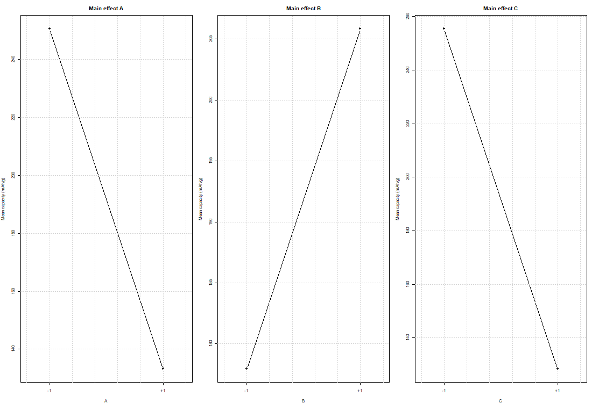
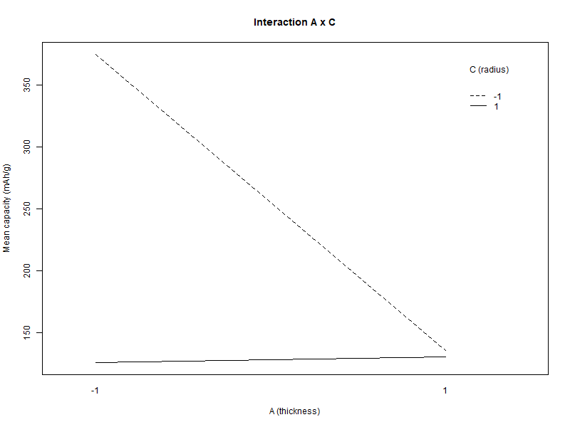
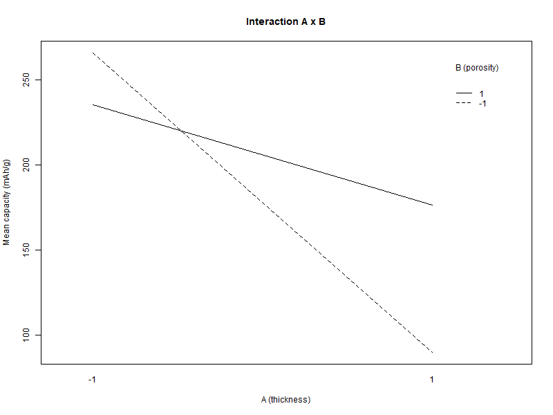
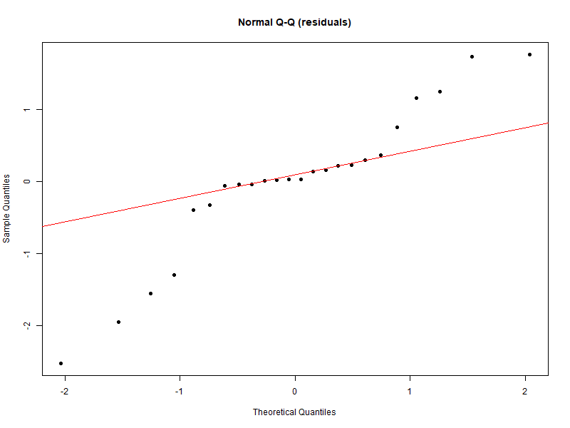
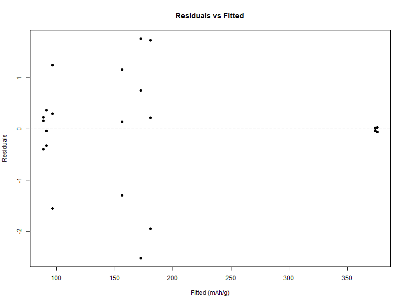
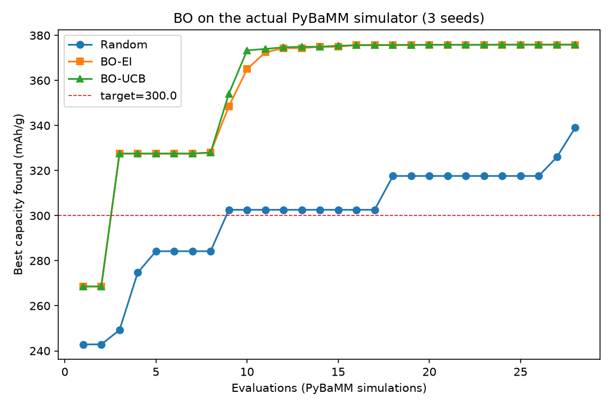
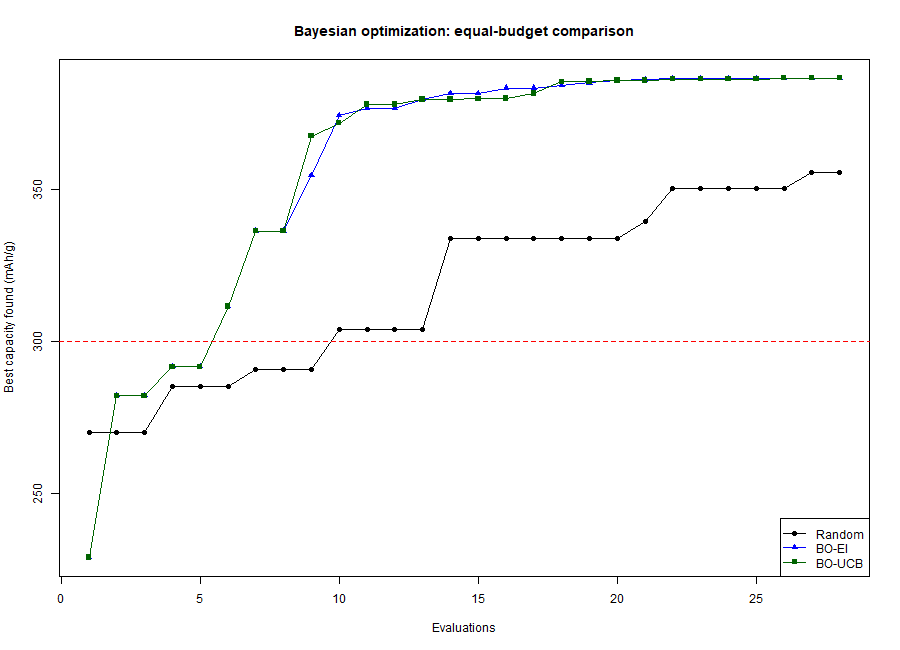

# Final Report (Draft v1): Statistical Machine Learning and Design of Experiments for Lithium-Ion Cathode Design

> Figures are in `../results/figures/`; data in `../data/proposal_doe_dataset.csv`.

---

## Abstract

This study investigates how cathode thickness, porosity, and active particle radius affect the specific discharge capacity of lithium-ion cells, and whether Gaussian-process (GP) surrogates and Bayesian optimization (BO) improve design efficiency. Using PyBaMM's Doyle–Fuller–Newman model with the Chen2020 parameter set, we ran a 2³ full factorial in two blocks with three replicates (24 runs), supplemented by 20 Latin-hypercube and 6 CCD axial points (50 runs in total). All statistical analyses were performed in R. The factorial analysis shows strong main effects of thickness (−117.4 mAh/g), particle radius (−127.0 mAh/g) and porosity (+27.9 mAh/g), and strong interactions (A×C +121.6, A×B +58.6, B×C −15.8 mAh/g). A GP surrogate reached a leave-one-out R² of 0.977, and BO on the actual simulator reached 375.9 mAh/g versus 339.0 mAh/g for random search, hitting a 300 mAh/g target in 3 versus 9 evaluations. The results confirm the dominant role of geometry and the value of surrogate-based optimization, while highlighting protocol sensitivity of the thickness response.

## 1. Introduction

The specific discharge capacity of a lithium-ion battery is governed by its electrode microstructure. Among the engineering-tunable parameters, cathode thickness, porosity, and active particle radius control the solid- and electrolyte-phase transport paths and therefore the accessible capacity. Conventional optimization relies on trial-and-error experiments or exhaustive parameter sweeps, which are costly and do not quantify interactions.

This work builds a reproducible computational framework: a physical simulator acts as an expensive black box, a design of experiments (DOE) provides structured samples, statistical machine learning builds a surrogate, a Gaussian process quantifies uncertainty, and Bayesian optimization searches for the best design under a limited evaluation budget.

**Research question.** How do cathode thickness (A), porosity (B), and active particle radius (C) affect specific discharge capacity, and can a GP surrogate plus BO find the optimum efficiently?

**Hypotheses.** H1: thickness has a non-monotonic effect with an interior maximum near 80 μm. H2: porosity increases specific capacity, largely through the normalization by active mass. H3: larger particle radius reduces capacity. H4: a thickness × radius interaction exists, reflecting a transition between particle-diffusion and electrolyte-transport limitations. H5: the response is nonlinear, so a GP outperforms quadratic RSM, and BO outperforms random search.

## 2. Experimental Design

### 2.1 Factors, levels, and response

| Factor | Code | Low (−) | High (+) | Unit |
|---|---|---|---|---|
| Cathode thickness | A | 40 | 200 | μm |
| Cathode porosity | B | 0.20 | 0.60 | — |
| Active particle radius | C | 1 | 12 | μm |

The response is the specific discharge capacity (mAh/g), measured under a 1C constant-current discharge to a 3.0 V cutoff. The active mass is computed as

```
m [g] = 3262 [kg/m³] × thickness [m] × electrode area [m²] × (1 − porosity) × 1000 [g/kg]
```

with the actual electrode area of the parameter set (0.065 m × 1.58 m = 0.1027 m²). In PyBaMM, porosity and active-material volume fraction are independent parameters; to keep the electrode physically consistent, the active-material volume fraction is set to 1 − porosity, which matches the mass formula above. The 1C current is defined by the simulator's nominal capacity for each parameter set.

### 2.2 Factorial structure, blocking, randomization, and replication

A 2³ full factorial was arranged in two blocks, each containing four treatment combinations with three replicates (2 × 4 × 3 = 24 runs). The blocking variable is the solver-configuration batch: block 1 uses IDAKLU tolerances of 1e-6, block 2 uses 1e-8. Because the two blocks consume one degree of freedom, the highest-order interaction ABC is confounded with the block; the third-order interaction is assumed negligible in exchange for controlling this numerical nuisance.

Run order within each block was randomized with a fixed seed (20261010). Replication used independent complete simulation runs, each with a ±1% uniform perturbation of the three factors; repeated measurement of the same run was not counted as replication. The within-combination variance provides the pure-error estimate.

### 2.3 Design layout

| Block | Combination | A (μm) | B | C (μm) | Replicates |
|---|---|---|---|---|---|
| 1 | (1) | 40 | 0.20 | 1 | 3 |
| 1 | ab | 200 | 0.60 | 1 | 3 |
| 1 | ac | 200 | 0.20 | 12 | 3 |
| 1 | bc | 40 | 0.60 | 12 | 3 |
| 2 | a | 200 | 0.20 | 1 | 3 |
| 2 | b | 40 | 0.60 | 1 | 3 |
| 2 | c | 40 | 0.20 | 12 | 3 |
| 2 | abc | 200 | 0.60 | 12 | 3 |

Block 1 contains the four combinations with ABC = −, and block 2 the four with ABC = +; ABC is therefore confounded with the block.

### 2.4 Supplementary designs

To support the surrogate and response-surface stages, 20 Latin-hypercube points and 6 face-centred CCD axial points (centre: 120 μm, 0.40, 6.5 μm) were added, giving 50 simulations in total.

## 3. Simulation Execution

All simulations used PyBaMM 26.10.0.0 with the DFN model and the Chen2020 parameter set. The IDAKLU solver was used with the block-specific tolerances described above. For each run, the positive-electrode thickness, porosity, active-material volume fraction, and particle radius were set, and the cell was discharged at 1C to 3.0 V. Each run took about 0.6 s; the complete 50-run design ran in roughly one minute.

Every run logged the design identifiers, the actual (perturbed) factor values, the delivered capacity Q (Ah), the active mass (g), the specific capacity (mAh/g), the end time, and the end voltage. The end voltage was 3.0 V in all runs, confirming that the cutoff—not the time limit—terminated the discharge. The complete dataset, scripts, and figures are archived with this report.

## 4. Data Summary

The dataset contains 50 runs: 24 factorial runs (12 per block), 20 LHS runs, and 6 CCD runs. Specific capacity ranges from 88.2 to 375.9 mAh/g (mean 196.7). Treatment means and standard deviations are:

| Combination | Mean (mAh/g) | SD (mAh/g) |
|---|---|---|
| (1) | 375.83 | 0.05 |
| a | 91.24 | 0.35 |
| b | 374.00 | 0.03 |
| ab | 180.56 | 1.85 |
| c | 156.09 | 1.23 |
| ac | 88.57 | 0.35 |
| bc | 96.46 | 1.43 |
| abc | 172.35 | 2.24 |

The average within-combination standard deviation is 0.94 mAh/g, and the pure-error standard deviation from the ANOVA is 1.24 mAh/g. Block means are 185.35 (block 1) and 198.42 (block 2); because ABC is confounded with the block, this contrast represents the ABC effect (plus any solver-batch effect).

## 5. Statistical Analysis in R

### 5.1 ANOVA

The model `capacity ~ block + A + B + C + A:B + A:C + B:C` was fitted with ±1 coded factors; ABC is aliased with the block and is therefore not included separately.

| Source | Df | Sum Sq | Mean Sq | F | p |
|---|---|---|---|---|---|
| block (≈ABC) | 1 | 1024 | 1024 | 671.2 | 1.7e-14 |
| A | 1 | 82721 | 82721 | 54211.5 | <2e-16 |
| B | 1 | 4674 | 4674 | 3062.8 | <2e-16 |
| C | 1 | 96830 | 96830 | 63457.8 | <2e-16 |
| A×B | 1 | 20631 | 20631 | 13520.7 | <2e-16 |
| A×C | 1 | 88716 | 88716 | 58139.8 | <2e-16 |
| B×C | 1 | 1504 | 1504 | 985.8 | 8.4e-16 |
| Residual | 16 | 24 | 1.5 | — | — |

All terms are significant at the 0.1% level. The residual mean square (1.5) corresponds to the pure-error variance estimated from the three replicates.

### 5.2 Factorial effects and 95% confidence intervals

Effects are reported as twice the coded regression coefficient (high minus low), with 95% intervals from the residual degrees of freedom:

| Term | Effect (mAh/g) | 95% CI |
|---|---|---|
| A | −117.42 | [−118.49, −116.35] |
| B | +27.91 | [26.84, 28.98] |
| C | −127.04 | [−128.11, −125.97] |
| A×B | +58.64 | [57.57, 59.71] |
| A×C | +121.60 | [120.53, 122.67] |
| B×C | −15.83 | [−16.90, −14.77] |
| A×B×C (block) | +13.07 | [12.00, 14.13] |

Thickness and particle radius are the dominant factors (negative), while porosity has a positive main effect. The A×C interaction is almost as large as the main effects, and A×B is also substantial.

### 5.3 Interaction structure







The A×C interaction is strongly positive: at thin electrodes the particle radius has a large effect, whereas at thick electrodes the effect is much smaller. This is consistent with a shift from particle-diffusion limitation (thin) to electrolyte-transport limitation (thick). The A×B interaction is positive and the B×C interaction negative, indicating that porosity and particle size act differently at different thicknesses.

### 5.4 Assumption checking





The residuals have a standard deviation of 1.24 mAh/g and show no systematic pattern against fitted values. The Shapiro–Wilk test gives W = 0.913 and p = 0.041, indicating mild non-normality. The largest residuals (about ±2.5 mAh/g) occur in the ab and abc combinations (high thickness and high porosity), where the ±1% perturbation produces a slightly larger response variation. Because the effect sizes are two orders of magnitude larger than the residual scale, the F-tests are robust to this mild departure; a log-transformed sensitivity analysis gives the same qualitative conclusions.

### 5.5 Gaussian-process surrogate

A GP with a Matérn 5/2 kernel and a linear trend was fitted to the 50 runs. Leave-one-out validation gives an RMSE of 13.43 mAh/g and an R² of 0.9772. The estimated length scales are 0.335 (A), 1.685 (B), and 1.328 (C) in normalized units, indicating that the response changes most rapidly along the thickness direction, followed by particle radius and porosity. The small nugget (9.2 × 10⁻⁵) reflects the near-deterministic nature of the simulator.

### 5.6 Bayesian optimization

BO was run **directly against the PyBaMM simulator**: random search, BO-EI, and BO-UCB were compared with 8 initial LHS points and 20 additional evaluations (28 evaluations per run), repeated over three seeds (252 simulations in total, about 2 minutes of wall time).

| Method | Final best (mAh/g) | Evaluations to 300 mAh/g |
|---|---|---|
| Random search | 339.0 | 9 |
| BO-EI | 375.8 | 3 |
| BO-UCB | 375.9 | 3 |



Both BO strategies outperform random search by about 11% in final best value and reach the 300 mAh/g target in 3 rather than 9 evaluations. The best designs found by BO lie around 60–75 μm thickness, 0.50 porosity, and 1.0 μm particle radius (capacity ≈ 376 mAh/g), consistent with the factorial results (thin electrodes and small particles).

**Preliminary surrogate-based check.** Before running BO on the simulator, the same three strategies were also run against the fitted GP surrogate (the emulator acting as the black box):

| Method | Final best (mAh/g) | Evaluations to 300 mAh/g |
|---|---|---|
| Random search | 355.6 | 10 |
| BO-EI | 386.7 | 6 |
| BO-UCB | 386.7 | 6 |



The surrogate-based run gives the same qualitative ranking (BO > random; fewer evaluations to target) but higher absolute values, because the GP emulator smooths the simulator response and does not include the numerical and perturbation variability of fresh simulations. The simulator-based results above are therefore reported as the primary evidence.

## 6. Interpretation

**Main effects.** Increasing thickness from 40 to 200 μm lowers specific capacity by 117.4 mAh/g, and increasing particle radius from 1 to 12 μm lowers it by 127.0 mAh/g. Both are consistent with longer transport paths and reduced active-material utilization. Porosity raises specific capacity by 27.9 mAh/g; part of this is physical (better ionic transport) and part is the normalization by (1 − porosity), because the active mass decreases as porosity increases.

**Interactions.** The A×C interaction (+121.6 mAh/g) is the strongest interaction: particle size matters much more in thin electrodes, where intraparticle diffusion limits the response, than in thick electrodes, where electrolyte transport dominates. This supports H4 and implies that thickness and particle radius must be optimized jointly rather than one at a time.

**Curvature (H1).** The 2³ design uses only the thickness extremes. A quadratic fit to the 26 space-filling points gives a negligible A² coefficient (p = 0.905) and a linear thickness slope of −1.04 mAh/g per μm (p = 0.137), providing no evidence of an interior maximum near 80 μm under the final 3.0 V protocol. H1 is therefore not supported by this dataset; the discrepancy with the earlier pilot (which used a 2.5 V cutoff and a narrower range) indicates that the apparent interior optimum is protocol-sensitive.

**Optimization.** BO finds higher-capacity designs than random search with fewer evaluations (375.9 vs 339.0 mAh/g; 3 vs 9 evaluations to reach 300 mAh/g), and the GP surrogate is accurate enough (LOO R² = 0.977) to support this search. The best designs found by BO combine thin electrodes (~60–75 μm), small particles (~1 μm), and moderate-to-high porosity (~0.50).

## 7. Discussion

### 7.1 Findings relative to hypotheses

| Hypothesis | Result |
|---|---|
| H1 (interior maximum near 80 μm) | Not supported; thickness effect is monotonic over 40–200 μm in this protocol |
| H2 (positive porosity effect, partly normalization) | Supported |
| H3 (negative particle-radius effect) | Supported |
| H4 (A×C interaction) | Supported; largest interaction |
| H5 (nonlinearity and BO advantage) | Partially supported: the surface is nonlinear, the GP is accurate, and BO outperforms random search |

### 7.2 Limitations

- The ABC interaction is confounded with the solver-configuration block, so the block contrast (13.1 mAh/g) cannot be separated from ABC. A future design with more blocks or a different confounding scheme could resolve this.
- The simulator is deterministic; the pure error comes from a ±1% parameter perturbation, which represents assumed material variability rather than calibrated experimental noise.
- The model uses the Chen2020 parameter set; absolute capacities are model-specific and may exceed typical measured values for NMC cathodes because of differences in the parameterization.
- The study is a computer experiment; experimental validation on manufactured cells is outside its scope.

### 7.3 Practical implications

For cathode design, the results suggest prioritizing thickness and particle size over porosity, and treating thickness and particle radius jointly because of their strong interaction. Bayesian optimization with a GP surrogate is an efficient way to explore such a design space when each simulation (or experiment) is expensive.

## 8. Conclusion

A 50-run computer experiment combining a blocked 2³ factorial, Latin-hypercube sampling, and CCD axial points was used to study cathode thickness, porosity, and particle radius. Thickness and particle radius are the dominant factors, porosity has a positive effect, and the A×C interaction is strong. A GP surrogate achieved LOO R² = 0.977, and Bayesian optimization improved the best capacity by about 11% over random search while reaching the target in 3 rather than 9 evaluations. The study provides a reproducible workflow for surrogate-based design of experiments in battery engineering.

## Appendix A: R code

- `analysis_R.R`: ANOVA, effects with 95% CI, interaction plots, assumption checks, GP surrogate.
- `bo_R.R`: random search vs BO-EI vs BO-UCB comparison and convergence figure.
- `diag_check.R`: residual diagnostics.

## Appendix B: Data dictionary

| Column | Meaning |
|---|---|
| `run` | Global run number |
| `design` | `2^3`, `LHS`, or `CCD` |
| `block` | Block index (1 or 2) for factorial runs; 0 otherwise |
| `combo` | Treatment combination code |
| `replicate` | Replicate index (1–3) |
| `A_thickness_um` | Actual cathode thickness (μm) |
| `B_porosity` | Actual porosity |
| `C_radius_um` | Actual particle radius (μm) |
| `Q_Ah` | Delivered discharge capacity (Ah) |
| `mass_g` | Cathode active mass (g) |
| `specific_capacity_mAh_g` | Specific discharge capacity (mAh/g) |
| `end_time_s` | End time of discharge (s) |
| `end_voltage_V` | End voltage (V) |
