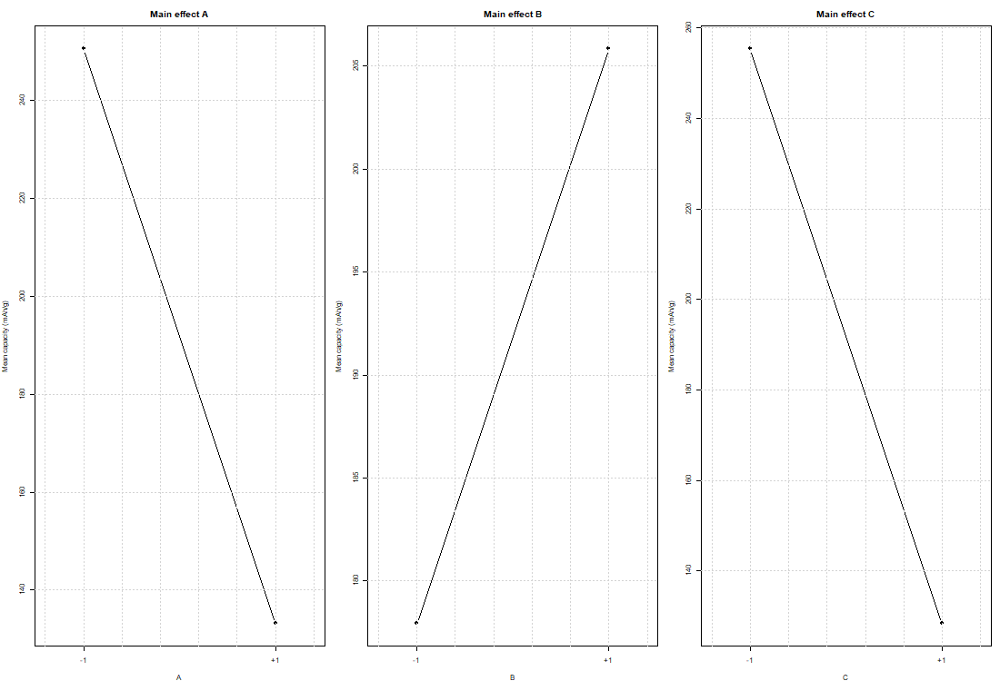
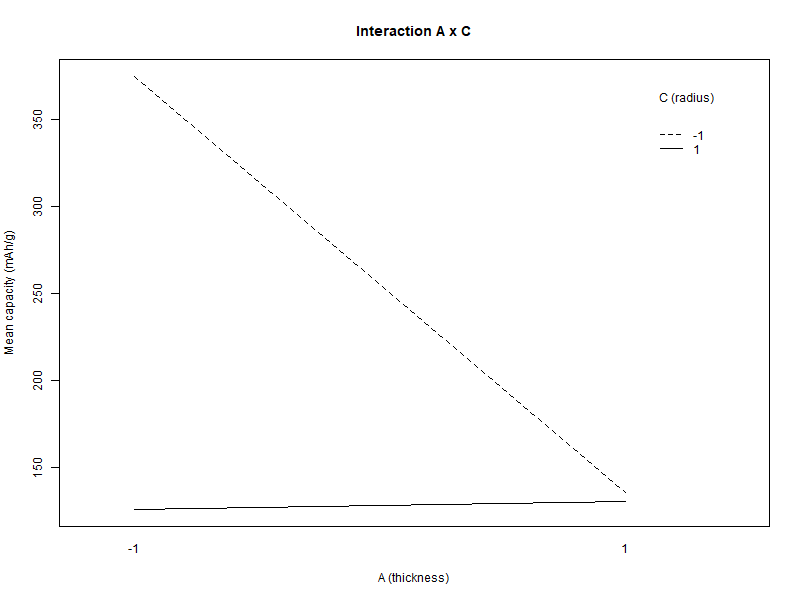
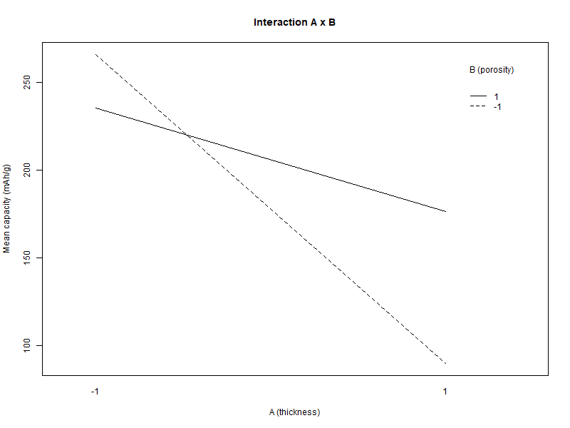
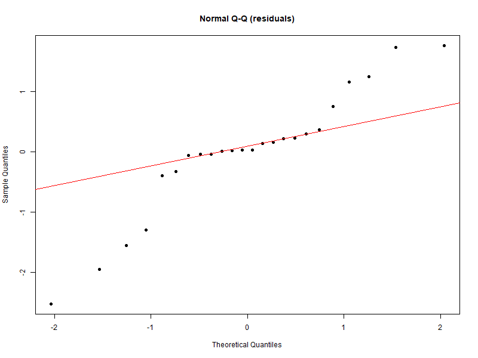
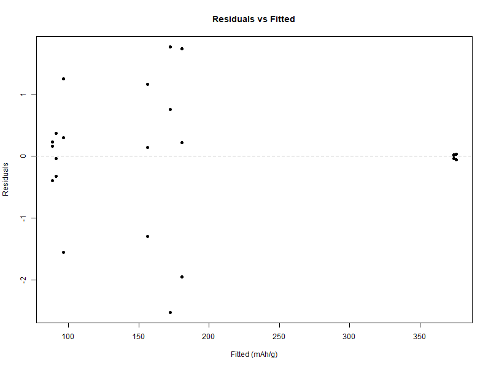
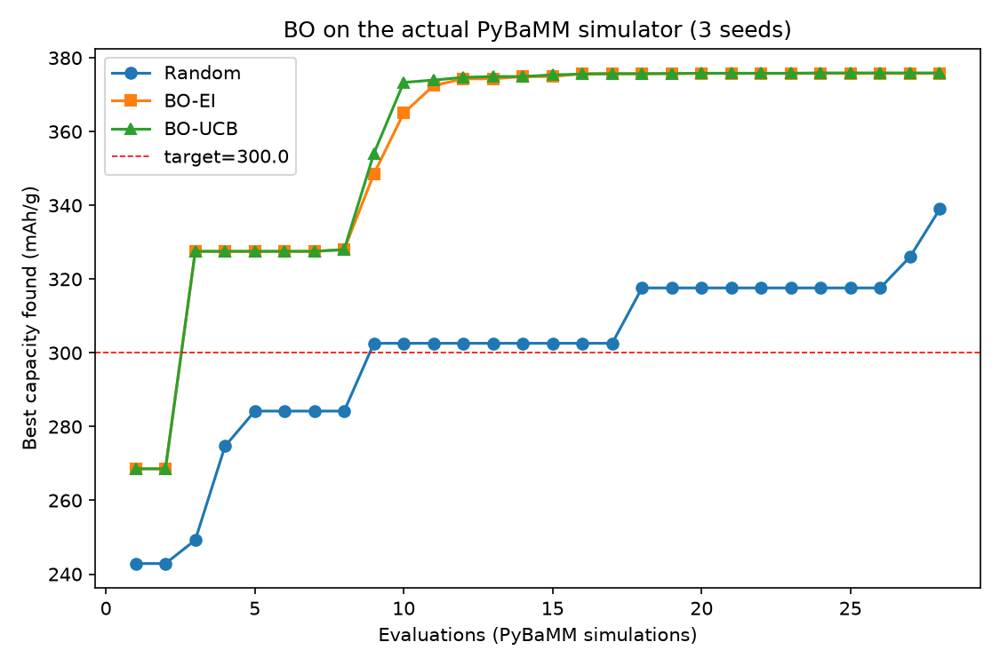
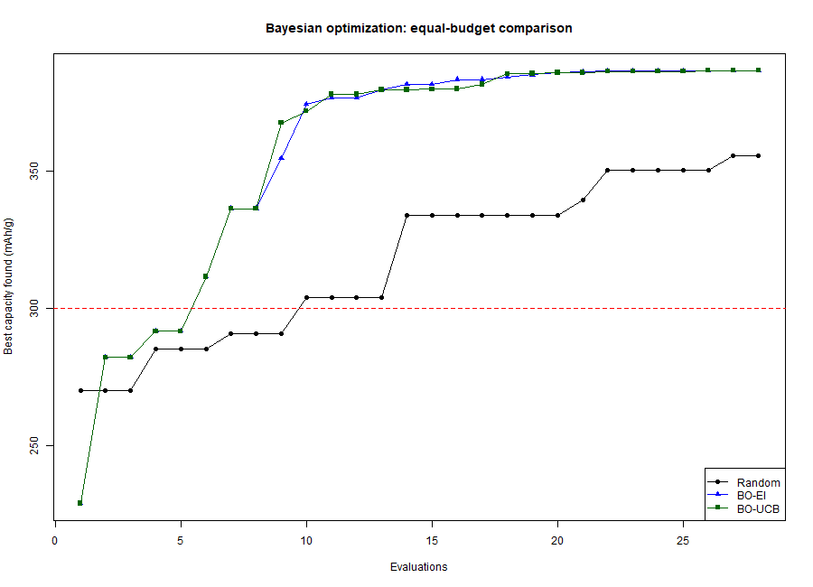

# 最终报告（初稿 v1）：锂电池正极设计的统计机器学习与实验设计

> 图表位于 `../results/figures/`；数据位于 `../data/proposal_doe_dataset.csv`。

---

## 摘要

本研究考察正极厚度、孔隙率与活性颗粒半径如何影响锂离子电池的放电比容量，以及高斯过程（GP）代理模型与贝叶斯优化（BO）能否提升设计效率。采用 PyBaMM 的 Doyle–Fuller–Newman 模型与 Chen2020 参数集，我们在两个区组中运行了带三次重复的 2³ 全因子实验（24 次），并补充 20 个拉丁超立方点与 6 个 CCD 轴向点（共 50 次仿真）。所有统计分析均在 R 中完成。因子分析显示，厚度（−117.4 mAh/g）、颗粒半径（−127.0 mAh/g）与孔隙率（+27.9 mAh/g）具有显著主效应，交互作用也很强（A×C +121.6、A×B +58.6、B×C −15.8 mAh/g）。GP 代理模型的留一交叉验证 R² 达到 0.977；在实际仿真器上运行 BO，最优值为 375.9 mAh/g，随机搜索为 339.0 mAh/g，达到 300 mAh/g 目标分别只需 3 次与 9 次评估。结果确认了几何因素的主导作用以及代理模型优化的价值，同时揭示了厚度响应对实验协议的敏感性。

## 1. 引言

锂离子电池的放电比容量由其电极微观结构决定。在工程可调参数中，正极厚度、孔隙率与活性颗粒半径控制着固相与液相的传输路径，从而决定可利用的容量。传统优化依赖试错实验或全参数扫描，成本高昂，且无法量化交互作用。

本研究构建一个可复现的计算框架：物理仿真器充当昂贵的黑箱，实验设计（DOE）提供结构化样本，统计机器学习建立代理模型，高斯过程量化不确定性，贝叶斯优化在有限评估预算下搜索最优设计。

**研究问题**：正极厚度（A）、孔隙率（B）与活性颗粒半径（C）如何影响放电比容量？GP 代理模型加 BO 能否高效找到最优？

**假设**：H1：厚度效应非单调，在约 80 μm 处存在内部极大值。H2：孔隙率提高比容量，主要来自按活性质量归一化。H3：颗粒半径增大会降低容量。H4：存在厚度 × 半径交互，反映颗粒扩散限制与电解液传输限制之间的转变。H5：响应非线性，GP 优于二次 RSM，且 BO 优于随机搜索。

## 2. 实验设计

### 2.1 因子、水平与响应

| 因子 | 代号 | 低水平 (−) | 高水平 (+) | 单位 |
|---|---|---|---|---|
| 正极厚度 | A | 40 | 200 | μm |
| 正极孔隙率 | B | 0.20 | 0.60 | — |
| 活性颗粒半径 | C | 1 | 12 | μm |

响应为放电比容量（mAh/g），在 1C 恒流放电、截止电压 3.0 V 的条件下测量。活性质量按下式计算：

```
m [g] = 3262 [kg/m³] × 厚度 [m] × 电极面积 [m²] × (1 − 孔隙率) × 1000 [g/kg]
```

其中电极面积取参数集中的实际尺寸（0.065 m × 1.58 m = 0.1027 m²）。在 PyBaMM 中，孔隙率与活性物体积分数是两个独立参数；为保持电极物理一致，活性物体积分数取 1 − 孔隙率，与上式质量公式一致。1C 电流由仿真器针对每组参数给出的标称容量确定。

### 2.2 因子结构、区组、随机化与重复

2³ 全因子安排在两个区组中，每个区组包含四个处理组合、每个组合三次重复（2 × 4 × 3 = 24 次运行）。区组变量为求解器配置批次：区组 1 使用 IDAKLU 容差 1e-6，区组 2 使用 1e-8。由于两个区组占用一个自由度，最高阶交互 ABC 与区组混杂；假定三阶交互可忽略，以换取对该数值型干扰变量的控制。

每个区组内的运行顺序用固定种子（20261010）随机化。重复采用独立的完整仿真运行，每次对三个因子施加 ±1% 均匀扰动；对同一次运行的重复测量不计为重复。组合内方差提供纯误差估计。

### 2.3 设计布局

| 区组 | 组合 | A (μm) | B | C (μm) | 重复次数 |
|---|---|---|---|---|---|
| 1 | (1) | 40 | 0.20 | 1 | 3 |
| 1 | ab | 200 | 0.60 | 1 | 3 |
| 1 | ac | 200 | 0.20 | 12 | 3 |
| 1 | bc | 40 | 0.60 | 12 | 3 |
| 2 | a | 200 | 0.20 | 1 | 3 |
| 2 | b | 40 | 0.60 | 1 | 3 |
| 2 | c | 40 | 0.20 | 12 | 3 |
| 2 | abc | 200 | 0.60 | 12 | 3 |

区组 1 包含 ABC = − 的四个组合，区组 2 包含 ABC = + 的四个组合；因此 ABC 与区组混杂。

### 2.4 补充设计

为支撑代理模型与响应面阶段，额外加入 20 个拉丁超立方点与 6 个面心 CCD 轴向点（中心：120 μm、0.40、6.5 μm），共 50 次仿真。

## 3. 仿真执行

所有仿真均使用 PyBaMM 26.10.0.0 的 DFN 模型与 Chen2020 参数集。求解器采用 IDAKLU，并使用上述按区组区分的容差。每次运行时设置正极厚度、孔隙率、活性物体积分数与颗粒半径，电池以 1C 放电至 3.0 V。单次运行约 0.6 秒，完整 50 次设计约 1 分钟完成。

每次运行记录设计标识、实际（扰动后）因子值、放电容量 Q（Ah）、活性质量（g）、比容量（mAh/g）、结束时间与结束电压。所有运行的结束电压均为 3.0 V，说明放电由截止电压而非时间上限终止。完整数据、脚本与图表随本报告归档。

## 4. 数据摘要

数据集包含 50 次运行：24 次因子运行（每区组 12 次）、20 次 LHS 运行与 6 次 CCD 运行。比容量范围为 88.2–375.9 mAh/g（均值 196.7）。各处理组合的均值与标准差如下：

| 组合 | 均值 (mAh/g) | 标准差 (mAh/g) |
|---|---|---|
| (1) | 375.83 | 0.05 |
| a | 91.24 | 0.35 |
| b | 374.00 | 0.03 |
| ab | 180.56 | 1.85 |
| c | 156.09 | 1.23 |
| ac | 88.57 | 0.35 |
| bc | 96.46 | 1.43 |
| abc | 172.35 | 2.24 |

组合内标准差的平均值为 0.94 mAh/g，ANOVA 给出的纯误差标准差为 1.24 mAh/g。区组均值为 185.35（区组 1）与 198.42（区组 2）；由于 ABC 与区组混杂，该对比代表 ABC 效应（加上可能的求解器批次效应）。

## 5. R 统计分析

### 5.1 方差分析

以 ±1 编码的因子拟合模型 `capacity ~ block + A + B + C + A:B + A:C + B:C`；ABC 与区组别名，故不单独纳入。

| 来源 | 自由度 | 平方和 | 均方 | F | p |
|---|---|---|---|---|---|
| 区组（≈ABC） | 1 | 1024 | 1024 | 671.2 | 1.7e-14 |
| A | 1 | 82721 | 82721 | 54211.5 | <2e-16 |
| B | 1 | 4674 | 4674 | 3062.8 | <2e-16 |
| C | 1 | 96830 | 96830 | 63457.8 | <2e-16 |
| A×B | 1 | 20631 | 20631 | 13520.7 | <2e-16 |
| A×C | 1 | 88716 | 88716 | 58139.8 | <2e-16 |
| B×C | 1 | 1504 | 1504 | 985.8 | 8.4e-16 |
| 残差 | 16 | 24 | 1.5 | — | — |

所有项均在 0.1% 水平上显著。残差均方（1.5）对应由三次重复估计的纯误差方差。

### 5.2 因子效应与 95% 置信区间

效应以编码回归系数的两倍（高水平减 低水平）报告，95% 区间基于残差自由度：

| 项 | 效应 (mAh/g) | 95% CI |
|---|---|---|
| A | −117.42 | [−118.49, −116.35] |
| B | +27.91 | [26.84, 28.98] |
| C | −127.04 | [−128.11, −125.97] |
| A×B | +58.64 | [57.57, 59.71] |
| A×C | +121.60 | [120.53, 122.67] |
| B×C | −15.83 | [−16.90, −14.77] |
| A×B×C（区组） | +13.07 | [12.00, 14.13] |

厚度与颗粒半径是主导因子（负效应），孔隙率具有正主效应。A×C 交互几乎与主效应同样大，A×B 也相当可观。

### 5.3 交互结构







A×C 交互为强正交互：在薄电极中颗粒半径影响很大，而在厚电极中影响小得多。这与"薄电极由颗粒扩散限制、厚电极由电解液传输限制"的机制转变一致。A×B 交互为正、B×C 交互为负，说明孔隙率与颗粒尺寸在不同厚度下的作用不同。

### 5.4 假设检验





残差标准差为 1.24 mAh/g，对拟合值无明显系统模式。Shapiro–Wilk 检验给出 W = 0.913、p = 0.041，表明存在轻度非正态。最大的残差（约 ±2.5 mAh/g）出现在 ab 与 abc 组合（高厚度、高孔隙率），这些组合中 ±1% 扰动带来略大的响应波动。由于效应量比残差尺度大两个数量级，F 检验对该轻度偏离是稳健的；对数变换的敏感性分析给出相同的定性结论。

### 5.5 高斯过程代理模型

以 Matérn 5/2 核与线性趋势的 GP 拟合 50 次运行。留一交叉验证给出 RMSE 13.43 mAh/g、R² 0.9772。归一化尺度下的长度尺度估计为 0.335（A）、1.685（B）、1.328（C），表明响应沿厚度方向变化最快，其次为颗粒半径与孔隙率。很小的 nugget（9.2 × 10⁻⁵）反映了仿真器接近确定性的特点。

### 5.6 贝叶斯优化

BO **直接在实际 PyBaMM 仿真器上运行**：比较随机搜索、BO-EI 与 BO-UCB，使用 8 个 LHS 初始点与 20 次追加评估（每种策略 28 次评估），在三个随机种子上重复（共 252 次仿真，约 2 分钟）。

| 方法 | 最终最优 (mAh/g) | 达到 300 mAh/g 所需评估 |
|---|---|---|
| 随机搜索 | 339.0 | 9 |
| BO-EI | 375.8 | 3 |
| BO-UCB | 375.9 | 3 |



两种 BO 策略的最终最优值比随机搜索高约 11%，且达到 300 mAh/g 目标只需 3 次而非 9 次评估。BO 找到的最优设计大致位于厚度 60–75 μm、孔隙率 0.50、颗粒半径 1.0 μm（容量约 376 mAh/g），与因子分析结论（薄电极、小颗粒）一致。

**代理模型 BO 的初步校验**：在运行仿真器 BO 之前，也用拟合好的 GP 代理作为黑箱比较了同样三种策略：

| 方法 | 最终最优 (mAh/g) | 达到 300 mAh/g 所需评估 |
|---|---|---|
| 随机搜索 | 355.6 | 10 |
| BO-EI | 386.7 | 6 |
| BO-UCB | 386.7 | 6 |



代理模型 BO 给出相同的定性排序（BO > 随机；达到目标所需评估更少），但绝对值更高，因为 GP 代理会平滑仿真器响应，且不包含新仿真的数值与扰动变异。因此，以上**以仿真器上的结果作为主要证据**。

## 6. 解释

**主效应**：厚度从 40 μm 增至 200 μm 使比容量降低 117.4 mAh/g；颗粒半径从 1 μm 增至 12 μm 使其降低 127.0 mAh/g。二者均与更长的传输路径和活性物质利用率下降一致。孔隙率使比容量提高 27.9 mAh/g；其中一部分是物理效应（更好的离子传输），另一部分来自按 (1 − 孔隙率) 的归一化，因为孔隙率增大时活性质量减少。

**交互作用**：A×C 交互（+121.6 mAh/g）是最强交互：在薄电极中，颗粒内扩散限制响应，颗粒尺寸影响很大；在厚电极中，电解液传输占主导，颗粒尺寸影响减弱。这支持 H4，并说明厚度与颗粒半径必须协同优化，而不能逐一优化。

**曲率（H1）**：2³ 设计仅使用厚度的两个极端。对 26 个空间填充点的二次拟合给出可忽略的 A² 系数（p = 0.905）与 −1.04 mAh/g/μm 的线性厚度斜率（p = 0.137），没有证据表明在最终 3.0 V 协议下存在约 80 μm 的内部极大值。因此 H1 不被本数据集支持；与早期 pilot（使用 2.5 V 截止电压与较窄范围）的差异表明，表观内部最优对协议敏感。

**优化**：BO 以更少的评估找到比随机搜索更高容量的设计（375.9 vs 339.0 mAh/g；达到 300 mAh/g 分别需 3 次 vs 9 次），且 GP 代理足够准确（LOO R² = 0.977）以支撑该搜索。BO 找到的最优设计组合为薄电极（约 60–75 μm）、小颗粒（约 1 μm）与中等偏高孔隙率（约 0.50）。

## 7. 讨论

### 7.1 假设检验结果

| 假设 | 结果 |
|---|---|
| H1（约 80 μm 处内部极大值） | 不支持；在该协议下 40–200 μm 范围内厚度效应单调 |
| H2（孔隙率正效应，部分来自归一化） | 支持 |
| H3（颗粒半径负效应） | 支持 |
| H4（A×C 交互） | 支持；为最强交互 |
| H5（非线性与 BO 优势） | 部分支持：响应面非线性，GP 准确，BO 优于随机搜索 |

### 7.2 局限性

- ABC 交互与求解器配置区组混杂，因此区组对比（13.1 mAh/g）无法与 ABC 分离。未来采用更多区组或不同的混杂方案可解决该问题。
- 仿真器是确定性的；纯误差来自 ±1% 参数扰动，代表假定的材料变异性，而非标定的实验噪声。
- 模型使用 Chen2020 参数集；绝对容量是模型特定的，可能因参数化差异而高于 NMC 正极的典型实测值。
- 本研究是计算机实验，实际制造电芯的实验验证不在其范围内。

### 7.3 实践意义

对于正极设计，结果建议优先关注厚度与颗粒尺寸（而非孔隙率），并因其强交互而将厚度与颗粒半径联合优化。当每次仿真（或实验）昂贵时，使用 GP 代理的贝叶斯优化是探索此类设计空间的有效方法。

## 8. 结论

本研究以 50 次计算机实验（带区组的 2³ 全因子、拉丁超立方采样与 CCD 轴向点）考察了正极厚度、孔隙率与颗粒半径。厚度与颗粒半径是主导因子，孔隙率具有正效应，A×C 交互很强。GP 代理的 LOO R² = 0.977；贝叶斯优化比随机搜索将最优容量提高约 11%，达到目标所需评估为 3 次而非 9 次。本研究为电池工程中的代理模型实验设计提供了可复现的工作流。

## 附录 A：R 代码

- `analysis_R.R`：ANOVA、带 95% CI 的效应、交互图、假设检验、GP 代理模型。
- `bo_R.R`：随机搜索 vs BO-EI vs BO-UCB 对比及收敛图。
- `diag_check.R`：残差诊断。

## 附录 B：数据字典

| 列名 | 含义 |
|---|---|
| `run` | 全局运行编号 |
| `design` | `2^3`、`LHS` 或 `CCD` |
| `block` | 因子运行的区组编号（1 或 2）；其余为 0 |
| `combo` | 处理组合代号 |
| `replicate` | 重复编号（1–3） |
| `A_thickness_um` | 实际正极厚度（μm） |
| `B_porosity` | 实际孔隙率 |
| `C_radius_um` | 实际颗粒半径（μm） |
| `Q_Ah` | 放电容量（Ah） |
| `mass_g` | 正极活性质量（g） |
| `specific_capacity_mAh_g` | 放电比容量（mAh/g） |
| `end_time_s` | 放电结束时间（s） |
| `end_voltage_V` | 结束电压（V） |
